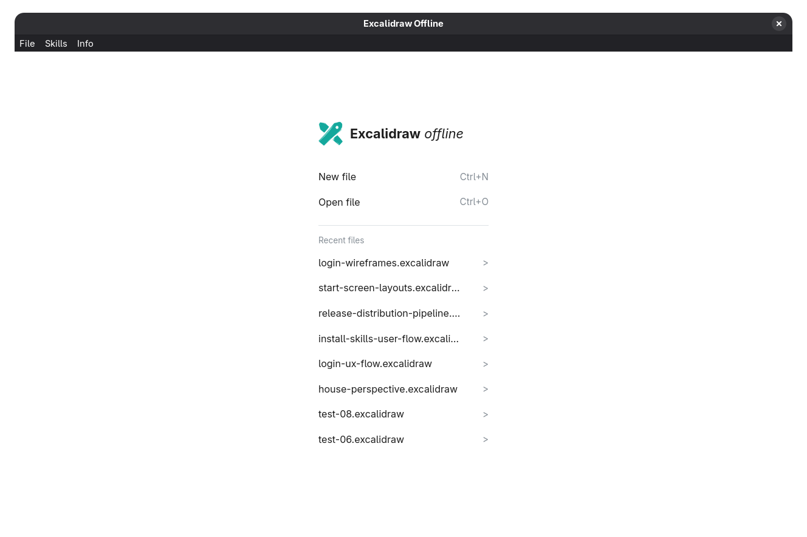
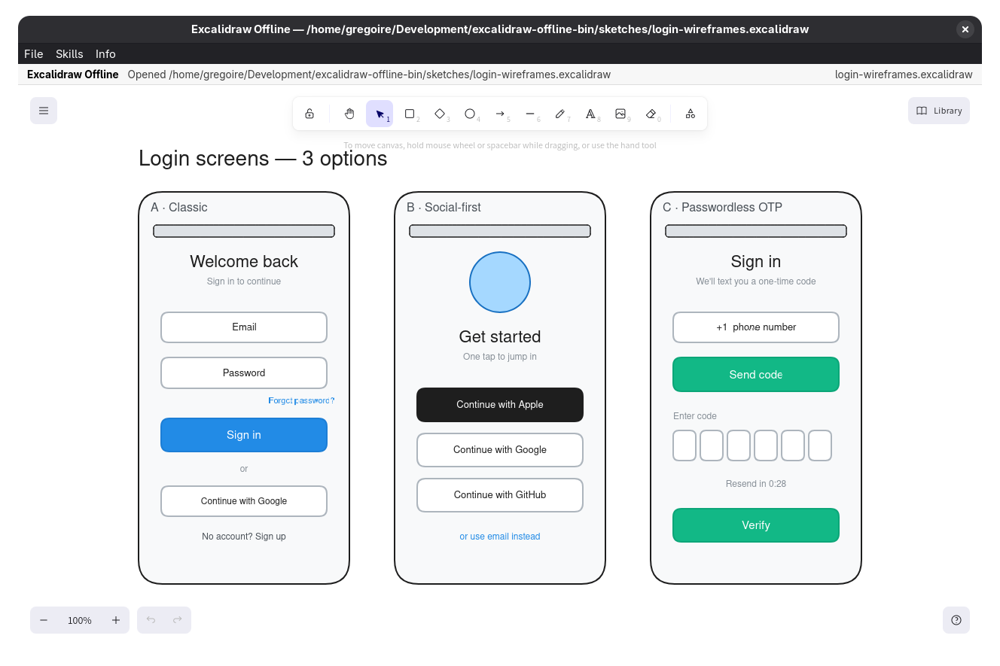

# Excalidraw Offline

Thin [Tauri 2](https://tauri.app/) wrapper around [@excalidraw/excalidraw](https://www.npmjs.com/package/@excalidraw/excalidraw) for offline desktop use on Linux, Windows 11, and macOS, for you and your AI agent 🤖. It does **not** rebuild Excalidraw — it packages the upstream React component and adds local file open/save/autosave plus durable `assets/` attachments.

**Status:** the **Tauri 2** port is end-to-end tested on Linux, Windows 11, and macOS (universal). It is not in a GitHub release yet — releases still ship the previous Deno Desktop builds ([v0.7.2](https://github.com/gfaurobert/excalidraw-offline-bin/releases/tag/v0.7.2) Linux; [v0.5.0](https://github.com/gfaurobert/excalidraw-offline-bin/releases/tag/v0.5.0) Windows/macOS). Get Tauri builds from CI artifacts or build from source — see [Install]({{ '/install.html' | relative_url }}). See also [What's new]({{ '/whats-new.html' | relative_url }}).

**Menus:** File (New, Open, Open Recent, Close, Reload, Save, Save As, Quit), **Skills** (install the `excalidraw-sketching` Agent Skill — Global / Project / Custom + agent checklist), **Info** (Runtime, Assets, About). **Export image…** (Ctrl+Shift+E) and the headless **export** CLI are included. See [Usage]({{ '/usage.html' | relative_url }}).

---

[Get started with Install]({{ '/install.html' | relative_url }}){: .btn .btn-primary .fs-5 .mb-4 .mb-md-0 .mr-2 }
[What's new]({{ '/whats-new.html' | relative_url }}){: .btn .fs-5 .mb-4 .mb-md-0 }
